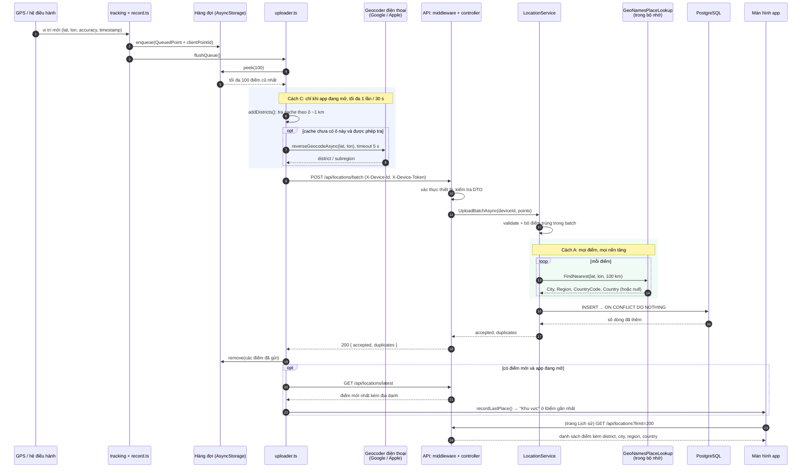
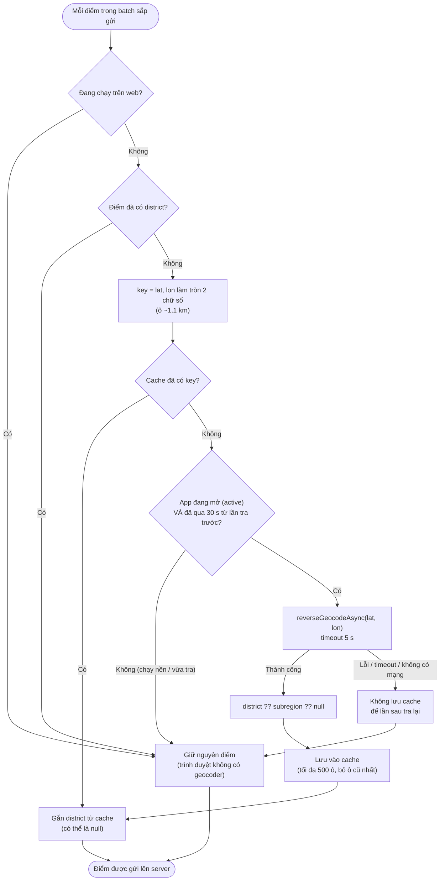
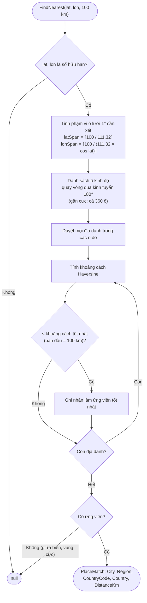
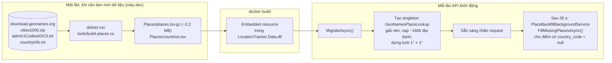

# Luồng xác định địa danh (thành phố, tỉnh, quốc gia, quận/phường)

Tài liệu này giải thích từ lúc điện thoại hoặc trình duyệt có một toạ độ GPS cho tới khi màn hình hiện dòng **Khu vực**, ví dụ "Hoàn Kiếm, Hanoi, Vietnam". Quy tắc chính thức nằm ở mục "Place names" trong [CLAUDE.md](../CLAUDE.md); tài liệu này tập trung vào **luồng chạy** và **lý do** của từng bước.

## 1. Hai nguồn địa danh

Địa danh của một điểm được ghép từ hai nguồn độc lập:

| Trường | Nguồn | Chạy ở đâu | Khi nào có |
|---|---|---|---|
| `city`, `region`, `countryCode`, `country` | Dữ liệu **GeoNames** nhúng sẵn trong API (cách A) | Server, offline, trong bộ nhớ | Mọi điểm, mọi nền tảng (web, điện thoại, chạy nền) |
| `district` (quận/phường) | **Geocoder của điện thoại** qua `expo-location` (cách C) | Điện thoại, gọi Google (Android) / Apple (iOS) | Chỉ khi app đang mở và có mạng; không có trên web |

Hai nguồn không phụ thuộc nhau: điện thoại tra không được quận/phường thì điểm vẫn có thành phố, tỉnh và quốc gia từ server.

## 2. Toàn cảnh luồng



### Giải thích từng bước

**Bước 1–3: có vị trí, cất vào hàng đợi trước.**
- Trên điện thoại, vị trí đến từ `watchPositionAsync` (app đang mở) hoặc từ background task. Trên web, vị trí đến từ `navigator.geolocation`.
- Mỗi điểm được gắn một `clientPointId` ngẫu nhiên rồi **vào hàng đợi trước khi gửi**, nên mất mạng cũng không mất điểm.
- Lúc này điểm **chưa có địa danh nào**.

**Bước 4–5: uploader lấy một batch.** Uploader lấy tối đa 100 điểm cũ nhất. Nếu một lần gửi khác đang chạy, lời gọi mới dùng chung lần đó chứ không chạy song song.

**Bước 6–8: tra quận/phường trên điện thoại (cách C).**
- Ngay trước khi gửi, `addDistricts()` cố gắn tên quận/phường cho các điểm chưa có. Chi tiết ở mục 3.
- Bước này được thiết kế để **không bao giờ chặn việc gửi**: tối đa một lần tra ngắn (5 giây). Không tra được thì điểm vẫn đi tiếp.

**Bước 9–12: API nhận batch.**
- Middleware kiểm tra `X-Device-Id` và `X-Device-Token`, controller kiểm tra DTO.
- `LocationService` áp các quy tắc nghiệp vụ: toạ độ hợp lệ, thời điểm không quá 5 phút trong tương lai và không quá 7 ngày trước, batch 1–100 điểm, bỏ điểm trùng trong cùng batch.
- `district` từ điện thoại chỉ được cắt khoảng trắng và rút gọn tối đa 100 ký tự, **không bao giờ là lý do để từ chối điểm**.

**Bước 13–14: tra thành phố, tỉnh, quốc gia (cách A).**
- Với từng điểm, `LocationService` gọi `IPlaceLookup.FindNearest(lat, lon, 100 km)`. Việc tra diễn ra hoàn toàn trong bộ nhớ, không gọi mạng, mỗi điểm mất vài micro-giây. Chi tiết ở mục 4.
- Không có khu dân cư nào trong 100 km (ví dụ giữa biển) thì các trường để `null`.

**Bước 15–19: lưu và trả kết quả.**
- Một câu `INSERT ... ON CONFLICT DO NOTHING` ghi cả batch. Điểm nào đã có (ví dụ gửi lại sau timeout) bị bỏ qua và tính là `duplicates`.
- Điện thoại xoá các điểm đã gửi khỏi hàng đợi.

**Bước 20–22: hiện "Khu vực" ở trang chính.**
- Địa danh do server tính, nên app phải hỏi lại server. Sau mỗi lần gửi thành công **khi app đang mở**, uploader gọi `GET /api/locations/latest` và lưu kết quả vào `statusStore.lastPlace`.
- Trang chính hiện giá trị đó ở dòng **Khu vực**. Khi app chạy nền thì bỏ qua bước này để tiết kiệm request.

**Bước 23–24: trang Lịch sử.** Trang này đọc thẳng danh sách điểm từ server, mỗi điểm đã có sẵn địa danh.

## 3. Tra quận/phường trên điện thoại (`addDistricts`)



Vì sao có các giới hạn này:

- **Chỉ khi app đang mở:** thư viện `expo-location` khuyên không gọi geocoder khi app chạy nền, và iOS chỉ cho task nền chạy rất ngắn. Task nền vẫn dùng được kết quả **đã có trong cache**, chỉ không gọi dịch vụ mới.
- **Tối đa 1 lần mỗi 30 giây:** Google và Apple đều giới hạn số lần gọi. Gọi dồn dập (ví dụ 100 điểm một lúc) sẽ bị chặn.
- **Cache theo ô khoảng 1 km:** toạ độ làm tròn 2 chữ số thập phân. Các điểm gần nhau dùng chung một kết quả, nên đi bộ trong cùng một khu chỉ tốn một lần tra. Đổi lại, ở ranh giới hai phường có thể bị gán nhầm phường bên cạnh.
- **Lỗi thì không lưu cache:** mất mạng hay bị giới hạn tần suất là chuyện tạm thời, lần sau sẽ tra lại ô đó. Còn khi geocoder trả lời thành công mà không có tên quận/phường, kết quả `null` vẫn được lưu để không tra lại vô ích.
- **`district`, nếu không có thì `subregion`:** Android và iOS điền các trường khác nhau. Lấy trường cụ thể nhất bên dưới cấp thành phố. Tên trả về theo **ngôn ngữ của máy**.

Hệ quả: các điểm ghi lúc **chạy nền** hoặc trên **web** thường không có quận/phường. Đây là chủ đích, không phải lỗi.

## 4. Tra thành phố, tỉnh, quốc gia trên server (`FindNearest`)



**Ý tưởng:**
- Khoảng 160 nghìn địa danh được chia vào các ô lưới 1° × 1° (mỗi ô khoảng 111 km × 111 km ở xích đạo).
- Thay vì so với cả 160 nghìn địa danh, ta chỉ so với các địa danh trong những ô mà bán kính 100 km có thể chạm tới.

**Ví dụ: một điểm ở Hồ Hoàn Kiếm (21,0285; 105,8542):**
1. `latSpan = ⌈100 / 111,32⌉ = 1`: xét các vĩ độ từ 20° tới 22°.
2. `cos(21,03°) ≈ 0,933`, nên `lonSpan = ⌈100 / (111,32 × 0,933)⌉ = ⌈0,96⌉ = 1`: xét các kinh độ từ 104° tới 106°.
3. Tổng cộng 3 × 3 = 9 ô, tức vài trăm địa danh quanh Hà Nội thay vì 160 nghìn.
4. Kết quả gần nhất: city `Hoàn Kiếm`, region `Hanoi`, country `VN` / `Vietnam`.

**Các trường hợp đặc biệt:**
- **Gần hai cực:** một độ kinh độ rất ngắn, nên phải xét nhiều ô kinh độ hơn. Khi `cos(lat)` gần 0, xét cả 360 ô.
- **Kinh tuyến 180°:** chỉ số ô được quay vòng, nên một điểm ở kinh độ 179,99° vẫn thấy địa danh ở −179,99° (ví dụ Fiji). Có test riêng cho trường hợp này.
- **Vì sao 100 km:** xa hơn thì "khu dân cư gần nhất" không còn nói lên điều gì (ví dụ đang ở giữa biển). Hằng số này là `LocationRules.MaxPlaceDistanceKm` trong tầng Business.

**Lưu ý về ý nghĩa của "thành phố":**
- `city` là **khu dân cư gần nhất** trong GeoNames, không phải ranh giới hành chính.
- Ở Hà Nội và TP.HCM, GeoNames liệt kê cả phường/quận (ví dụ `Hoàn Kiếm`, `Quận Một`), nên `city` thường là tên phường/quận, còn `region` mới là thành phố/tỉnh.
- Sát biên giới có thể gán nhầm nước. Tên địa danh giữ nguyên cách viết của GeoNames.
- Bản dữ liệu trong repo là bản GeoNames ngày 27/10/2026:
  - Cấp **tỉnh** của Việt Nam đã theo đợt sáp nhập tháng 7/2025 (34 tỉnh/thành).
  - Cấp **dưới** vẫn còn tên quận cũ như `Quận Một`, `Quận Bình Thạnh`, nên `city` có thể mang tên quận trước 2025.
  - Tên tỉnh viết không đồng nhất, lúc không dấu, lúc có dấu (`Phu Tho`, `Hà Tĩnh Province`).

## 5. Dữ liệu đến từ đâu và được nạp khi nào



**Tạo dữ liệu** (`tools/build-places.cs`):
- Tool tải 3 file từ GeoNames.
- Chỉ giữ các khu dân cư (feature class `P`), bỏ địa danh lịch sử, đã bỏ hoang và các "khu vực con của thành phố" (`PPLX`, `PPLH`, `PPLQ`, `PPLW`, `PPLCH`).
- Ghép tên tỉnh từ `admin1CodesASCII.txt` và tên quốc gia từ `countryInfo.txt`.
- Kết quả là hai file nhỏ được commit vào repo, nên `docker build` không phụ thuộc vào việc GeoNames có đang hoạt động hay không.

**Nạp vào bộ nhớ:**
- Khi API khởi động, ngay sau migration, `GeoNamesPlaceLookup` được tạo một lần (singleton). Việc này giúp request upload đầu tiên không phải chờ nạp dữ liệu.
- Toàn bộ API dùng khoảng 125 MB RAM, vẫn vừa với gói free của Render (512 MB).

**Bù dữ liệu cũ:** khoảng 30 giây sau khi khởi động, `PlaceBackfillBackgroundService` tìm các điểm chưa có `country_code` (lưu trước khi có tính năng này) và điền địa danh cho chúng.

### Dữ liệu có phải cập nhật định kỳ không?

**Không bắt buộc.** Hai file trong `Places/` là một **bản chụp cố định**:
- không có gì tự cập nhật chúng, dù lúc build hay lúc chạy;
- không có lịch cập nhật tự động.

App và API dùng bản hiện tại được mãi; dữ liệu chỉ "cũ đi" về mặt nội dung.

Nên chạy lại `dotnet run tools/build-places.cs` khi:
- có **thay đổi hành chính** liên quan tới nơi bạn dùng app (như đợt sáp nhập 2025);
- người dùng báo **tên sai hoặc thiếu**;
- hoặc đơn giản là **khoảng mỗi năm một lần**. GeoNames cập nhật hằng ngày, nhưng mỗi ngày chỉ thay đổi rất ít.

Sau khi chạy: commit hai file mới; Render tự deploy vì file nằm trong `backend/src/`. Lưu ý:
- chỉ các điểm gửi lên **sau đó** mới mang tên mới;
- điểm cũ giữ tên cũ, vì việc bù dữ liệu chỉ điền cho điểm **chưa có** quốc gia, không viết lại tên đã có.

Với database free của Render (hết hạn sau 30 ngày) thì việc này gần như không quan trọng.

## 6. Dữ liệu trên đường truyền

Điện thoại gửi lên (`district` là tuỳ chọn; client **không bao giờ** gửi `city`, `region` hay `country`):

```json
{
  "points": [
    {
      "clientPointId": "4f7c0d3e-8a1b-4c2d-9e3f-0a1b2c3d4e5f",
      "latitude": 21.0285,
      "longitude": 105.8542,
      "accuracy": 12.5,
      "recordedAt": "2026-10-27T13:00:00Z",
      "source": "foreground",
      "district": "Hoàn Kiếm"
    }
  ]
}
```

Server trả về khi đọc lại (`GET /api/locations/latest`):

```json
{
  "id": 42,
  "clientPointId": "4f7c0d3e-8a1b-4c2d-9e3f-0a1b2c3d4e5f",
  "latitude": 21.0285,
  "longitude": 105.8542,
  "accuracy": 12.5,
  "recordedAt": "2026-10-27T13:00:00+00:00",
  "receivedAt": "2026-10-27T13:00:01.2+00:00",
  "source": "foreground",
  "district": "Hoàn Kiếm",
  "city": "Hoàn Kiếm",
  "region": "Hanoi",
  "countryCode": "VN",
  "country": "Vietnam"
}
```

Màn hình ghép các phần lại bằng `formatPlace()`, bỏ phần trống và phần trùng lặp (không phân biệt hoa thường). Ví dụ trên hiện thành **"Hoàn Kiếm, Hanoi, Vietnam"**.

Trong database, các giá trị này nằm ở các cột `district`, `city`, `region`, `country_code`, `country` của bảng `location_points`, tất cả đều cho phép `null`.

## 7. Kết quả theo từng tình huống

| Tình huống | Quận/phường | Thành phố, tỉnh, quốc gia | Ghi chú |
|---|---|---|---|
| Điện thoại, app đang mở, có mạng | Thường có | Có | Trường hợp đầy đủ nhất |
| Điện thoại, app chạy nền / màn hình khoá | Chỉ khi ô đó đã có trong cache | Có | Task nền không gọi geocoder |
| Web | Không | Có | Trình duyệt không có geocoder |
| Mất mạng khi ghi điểm | Thường không | Có, khi điểm được gửi lên sau | Điểm nằm trong hàng đợi tới khi có mạng |
| Giữa biển, xa mọi khu dân cư trên 100 km | Tuỳ geocoder | Không (`null`) | App hiện "Không xác định" |
| Sát biên giới | Theo geocoder | Có thể sai nước | Do dùng "khu dân cư gần nhất" |
| Điểm lưu trước khi có tính năng | Không | Có, sau lần API khởi động kế tiếp | Nhờ backfill |
| Máy không có Google Play services | Không | Có | Geocoder báo lỗi, lỗi đó được bỏ qua |

## 8. Quyền riêng tư

- **Cách A** không gửi toạ độ đi đâu: mọi việc diễn ra trong API của dự án.
- **Cách C** gửi toạ độ cho Google (Android) hoặc Apple (iOS), nhưng **chỉ khi app đang mở**. Màn hình thông báo thu thập dữ liệu ([app/disclosure.tsx](../mobile/app/disclosure.tsx)) nói rõ cả hai điều này, và đây là yêu cầu bắt buộc trong CLAUDE.md.
- Dữ liệu GeoNames dùng giấy phép CC BY 4.0. App ghi nguồn ở Cài đặt → Thông tin.

## 9. Bản đồ mã nguồn

| Bước | File |
|---|---|
| Ghi điểm vào hàng đợi | [mobile/src/location/record.ts](../mobile/src/location/record.ts), [queue.ts](../mobile/src/location/queue.ts) |
| Tra quận/phường (điện thoại) | [mobile/src/location/district.native.ts](../mobile/src/location/district.native.ts) |
| Bỏ qua trên web | [mobile/src/location/district.web.ts](../mobile/src/location/district.web.ts) |
| Gửi batch, lấy địa danh mới nhất | [mobile/src/location/uploader.ts](../mobile/src/location/uploader.ts) |
| Ghép chuỗi hiển thị | [mobile/src/ui/format.ts](../mobile/src/ui/format.ts) (`formatPlace`) |
| Màn hình | [mobile/app/index.tsx](../mobile/app/index.tsx), [history.tsx](../mobile/app/history.tsx) |
| DTO request/response | [backend/src/LocationTracker.Api/Contracts/LocationContracts.cs](../backend/src/LocationTracker.Api/Contracts/LocationContracts.cs) |
| Gán địa danh khi nhận batch, backfill | [backend/src/LocationTracker.Business/Services/LocationService.cs](../backend/src/LocationTracker.Business/Services/LocationService.cs) |
| Ngưỡng 100 km, chuẩn hoá `district` | [backend/src/LocationTracker.Business/Validation/LocationRules.cs](../backend/src/LocationTracker.Business/Validation/LocationRules.cs) |
| Tra cứu GeoNames trong bộ nhớ | [backend/src/LocationTracker.Data/Places/GeoNamesPlaceLookup.cs](../backend/src/LocationTracker.Data/Places/GeoNamesPlaceLookup.cs) |
| Lưu các cột địa danh | [backend/src/LocationTracker.Data/Repositories/LocationRepository.cs](../backend/src/LocationTracker.Data/Repositories/LocationRepository.cs) |
| Backfill lúc khởi động | [backend/src/LocationTracker.Api/Places/PlaceBackfillBackgroundService.cs](../backend/src/LocationTracker.Api/Places/PlaceBackfillBackgroundService.cs) |
| Tạo lại dữ liệu GeoNames | [backend/tools/build-places.cs](../backend/tools/build-places.cs) |
